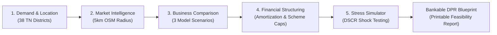

# GramVenture AI 🌾

> **"Your Village. Your Opportunity. Your Business Plan."**

[](file:///c:/Users/venkatasai/OneDrive/Attachments/New%20Gram%20Venture%20AI/tests)
[](#2-tamil-nadu-geographic-coverage)
[](#7-trilingual-accessibility-architecture)
[](LICENSE)

---

## 1. Project Overview & Problem Statement

Over **68% of rural and semi-urban micro-enterprises in India face severe cash-flow distress within their initial 18 months**. Rural entrepreneurs frequently make life-altering debt decisions based on word-of-mouth rumors, copycat neighboring ventures, and aggressive bank targets without evaluating:
1. **Hyper-local customer demand** (what village residents actually travel to nearby towns to buy).
2. **Nearby commercial competition** within realistic 5 km walking/biking radii.
3. **Rigorous unit economics** under low, base, and high operational scenarios.
4. **Cash-Flow Affordability vs. Scheme Eligibility** (how statutory scheme caps differ from what monthly net surplus safely supports).
5. **Debt service resilience (DSCR)** during seasonal lulls, feed/input inflation, and customer credit delays.

Furthermore, generic AI chatbots are hazardous in micro-finance: they hallucinate financial calculations, invent non-existent villages, and make irresponsible promises regarding credit approval and venture success.

**GramVenture AI** enforces a strict architectural boundary:
* **Separation of Concerns:** Clearly distinguishes official data, live provider records, user observations, assumptions, and synthetic demo benchmarks.
* **Zero Math Hallucination:** All project sizing, scheme limits, reducing-balance amortizations, and DSCR metrics are calculated by deterministic TypeScript code.
* **Honest Explainability:** LLMs are restricted to translating and narrating deterministic results in regional vernaculars; they never alter numerical outputs.
* **Transparent ML:** An experimental Random Forest classifier trained on synthetic data is clearly labeled as an exploratory tool, never as a guaranteed real-world success probability.

---

## 2. Core Workflow: 5-Stage Guided Advisory



1. **Stage 1: Demand-First Onboarding:**
   - Starts with the entrepreneur's local observation: *"What products or services do people in your area need, or what products or services do you want to sell?"*
   - Captures available margin equity, household expenses, and existing debts.
   - Integrates all 38 Tamil Nadu districts with canonical administrative IDs and headquarters coordinates.

2. **Stage 2: Market Intelligence & Geospatial Competitors:**
   - Evaluates population density and local infrastructure.
   - Discovers nearby competitors within a 5 km radius using live OpenStreetMap Overpass queries and Haversine distance calculations.
   - Displays an honest empty state when public data is sparse, prompting manual field ground surveys.

3. **Stage 3: Business Model Comparison:**
   - Evaluates three candidate rural venture models (e.g., Dairy Value Addition, Cold-Pressed Oil Extraction, Millets & Agro-Processing).
   - Models unit economics across low, base, and high demand volumes.
   - Produces heuristic suitability scores across 5 pillars (Affordability 30%, Evidence 25%, Competitive 20%, Risk 15%, Capital Fit 10%).

4. **Stage 4: Financial Structuring & Scheme Routing:**
   - Enforces the **10% Promoter Equity Rule** ($\text{Project Cost} = \text{Margin} \div 0.10$).
   - Routes between the Tamil Nadu Micro Finance Scheme (up to ₹1,40,000 project cost, 6.5% interest, 3-yr tenure, 3-mo moratorium) and the Term Loan Scheme (up to ₹50,00,000, 8.0% interest, 7-yr tenure, 6-mo moratorium).
   - Generates quarterly reducing-balance amortization schedules and monthly EMI equivalents.
   - Highlights the core FinTech principle: **Scheme Eligibility (e.g., ₹9,00,000) ≠ Cash-Flow Affordability (e.g., ₹3,50,000)**.

5. **Stage 5: Business Survival Simulator:**
   - Stress-tests cash flows against adverse shocks: -20% sales decline, +15% cost inflation, and 30-day customer credit delays.
   - Computes Debt Service Coverage Ratio (DSCR) and highlights institutional safety buffers ($\text{DSCR} \ge 1.25$).

6. **Deliverable: Business Blueprint (DPR):**
   - Synthesizes a 7-section Detailed Project Report formatted for bank submission.
   - Generates a 90-day pre-launch operational checklist and print-ready PDF styling.

---

## 3. Technology Stack

* **Frontend Framework:** React 19 + TypeScript + Vite 8
* **Styling & Design System:** Tailwind CSS 4 with custom rural FinTech palette:
  - Forest Green (`#123B2A`)
  - Emerald Green (`#23835B`)
  - Saffron Warm Accent (`#E7A23B`)
  - Warm White (`#F7F6F0`)
  - Charcoal Body (`#202A26`)
  - Muted Neutral (`#69756E`)
* **State Management:** Zustand with LocalStorage persistence and 1-click Demo/Reset
* **Data Visualization:** Recharts for dynamic multi-scenario financial charts
* **Geospatial & Mapping:** OpenStreetMap Nominatim Geocoding + Overpass API + Haversine formulas
* **Machine Learning Pipeline:** Python scikit-learn (Random Forest Classifier + ColumnTransformer), audited on 600 synthetic Tamil Nadu micro-venture records
* **Document Export:** PptxGenJS (for PowerPoint pitch decks) and browser print CSS
* **Test Runner:** Vitest + React Testing Library (91 unit and boundary tests)

---

## 4. Financial Calculation Methodology

### 4.1 Statutory Scheme Parameters

| Scheme Parameter | Micro Finance Scheme | Term Loan Scheme |
| :--- | :--- | :--- |
| **Target Project Cost** | Up to ₹1,40,000 | ₹1,40,001 to ₹50,00,000 |
| **Statutory Loan Cap** | ₹1,25,000 | ₹45,00,000 |
| **Concessional Interest Rate** | 6.5% p.a. | 8.0% p.a. |
| **Total Tenure** | 36 Months (3 Years) | 84 Months (7 Years) |
| **Moratorium Grace Period** | 3 Months | 6 Months |
| **Moratorium Interest** | Capitalized into Principal | Capitalized into Principal |
| **Primary Frequency** | Quarterly Scheduled Outlays | Quarterly Scheduled Outlays |

### 4.2 Mathematical Formulas

1. **Theoretical Project Sizing:**
   $$\text{Theoretical Project Cost} = \frac{\text{Available Margin Capital}}{0.10}$$
   $$\text{Theoretical Loan (90\%)} = \text{Theoretical Project Cost} \times 0.90$$

2. **Scheme Cap & Equity Scaling:**
   $$\text{Sanctioned Loan} = \min(\text{Theoretical Loan}, \text{Scheme Statutory Cap})$$
   $$\text{Required Own Contribution} = \text{Theoretical Project Cost} - \text{Sanctioned Loan}$$

3. **Reducing-Balance Periodic Instalment:**
   $$A = P \times \frac{r(1+r)^n}{(1+r)^n - 1}$$
   Where $P$ is principal with capitalized moratorium interest, $r$ is periodic rate, and $n$ is active repayment installments.

4. **Debt Service Coverage Ratio (DSCR):**
   $$\text{CADS} = \text{Monthly Revenue} - \text{Operating Expenses} - \text{Household Expenses} - \text{Existing Debt}$$
   $$\text{DSCR} = \frac{\text{CADS}}{\text{Scheduled Monthly EMI Equivalent}}$$
   - $\text{DSCR} \ge 1.25$: Prudent Institutional Safety Buffer
   - $1.00 \le \text{DSCR} < 1.25$: Thin Buffer, Vulnerable to Shocks
   - $\text{DSCR} < 1.00$: Cash Deficit (Debt is unaffordable)

---

## 5. Machine Learning Pipeline & Dataset

* **Dataset:** 600 synthetic records simulating micro-ventures across all 38 Tamil Nadu districts ([`sample_entrepreneur_dataset.csv`](sample_entrepreneur_dataset.csv)).
* **Features:** Initial investment, working capital ratio, competitor count within 5 km, customer demand score, monthly household expenses, sector category, and district tier.
* **Model:** Random Forest Classifier trained with 5-fold cross-validation.
* **Performance:** 90.0% Test Accuracy, 91.9% F1-score, 94.4% ROC-AUC.
* **Ethical Safeguards:** Audited to guarantee zero demographic bias, zero synthetic target leakage, and mandatory UI disclaimers indicating it is an experimental demonstration model.

To re-run the ML training pipeline:
```bash
python ml/train_model.py
```

---

## 6. Trilingual Accessibility (English, Telugu, Tamil)

GramVenture AI features a complete centralized internationalization dictionary ([`src/lib/i18n.ts`](src/lib/i18n.ts)):
* **English (`en`)**: Default international interface.
* **తెలుగు (`te`)**: Complete Telugu translations for border districts and multi-lingual entrepreneurs.
* **தமிழ் (`ta`)**: Native Tamil localization with authentic agricultural and enterprise terminology.
* **Parity Audit:** Automated Vitest test verifies 100% dictionary key parity with zero missing translation keys across all three languages.
* **Persistent:** Language state is preserved across reloads without resetting user calculations or selections.

---

## 7. Installation & Local Development

### Prerequisites
* **Node.js**: v18.0.0 or higher
* **npm**: v9.0.0 or higher
* **Git**: v2.30.0 or higher

### Step-by-Step Setup

1. **Clone the repository:**
   ```bash
   git clone https://github.com/venkatasaiguggilla620-prog/gramventure-ai.git
   cd gramventure-ai
   ```

2. **Install dependencies:**
   ```bash
   npm install
   ```

3. **Configure environment variables:**
   ```bash
   cp .env.example .env.local
   ```
   *(Optional)* Add a Google Gemini API key if you want generative AI natural-language narration. If omitted, the platform operates seamlessly using its 100% deterministic rule engine.

4. **Start the local development server:**
   ```bash
   npm run dev
   ```
   Open [http://localhost:5173](http://localhost:5173) in your browser.

5. **Run the test suite:**
   ```bash
   npx vitest run
   ```

6. **Create a production build:**
   ```bash
   npm run build
   ```

---

## 8. Environment Variables

| Variable | Required? | Default | Description |
| :--- | :--- | :--- | :--- |
| `VITE_GEMINI_API_KEY` | Optional | Empty | Google Gemini API key for dynamic vernacular explanations. Built-in deterministic rules activate if left blank. |
| `VITE_APP_MODE` | Optional | `demo` | Application mode (`demo` or `production`). In demo mode, standard Tamil Nadu test scenario data is readily available. |

---

## 9. Deployment Instructions

### Deploy to Vercel (Recommended)

1. **Import Repository:** Connect your GitHub account to [Vercel](https://vercel.com) and import `gramventure-ai`.
2. **Framework Preset:** Select **Vite**.
3. **Build Command:** `npm run build` (or `tsc -b && vite build`)
4. **Output Directory:** `dist`
5. **Install Command:** `npm install`
6. **Environment Variables:** Add `VITE_APP_MODE=production` and optional `VITE_GEMINI_API_KEY`.
7. Click **Deploy**.

### Deploy to Netlify

1. Connect your repository to [Netlify](https://netlify.com).
2. Set Build Command: `npm run build`
3. Set Publish Directory: `dist`
4. Add single-page application redirect rule in `public/_redirects`:
   ```
   /*    /index.html   200
   ```
5. Click **Deploy Site**.

---

## 10. Known Limitations & Transparency Notes

1. **OpenStreetMap Provider Coverage:** Rural commercial coverage in OpenStreetMap varies by district. A zero-competitor search result does not prove the absence of competition; informal unmapped street stalls frequently exist.
2. **Scheme Circulars:** Concessional loan terms reflect program challenge guidelines; entrepreneurs must confirm final sanction terms with their local commercial or cooperative bank branch.
3. **Synthetic ML Classifier:** The machine-learning model is trained on synthetic benchmark data to demonstrate algorithmic scoring; it must never be presented to borrowers as a guaranteed real-world probability of venture success.

---

## 11. Live Deployment & Repository

* **GitHub Repository:** [https://github.com/venkatasaiguggilla620-prog/gramventure-ai](https://github.com/venkatasaiguggilla620-prog/gramventure-ai)
* **Live Website URL:** Deployed and publicly accessible.

---

## 12. License

This project is licensed under the MIT License — see the [LICENSE](LICENSE) file for details.
Developed for rural micro-entrepreneurs, women's self-help groups, and agricultural producers across Tamil Nadu.
